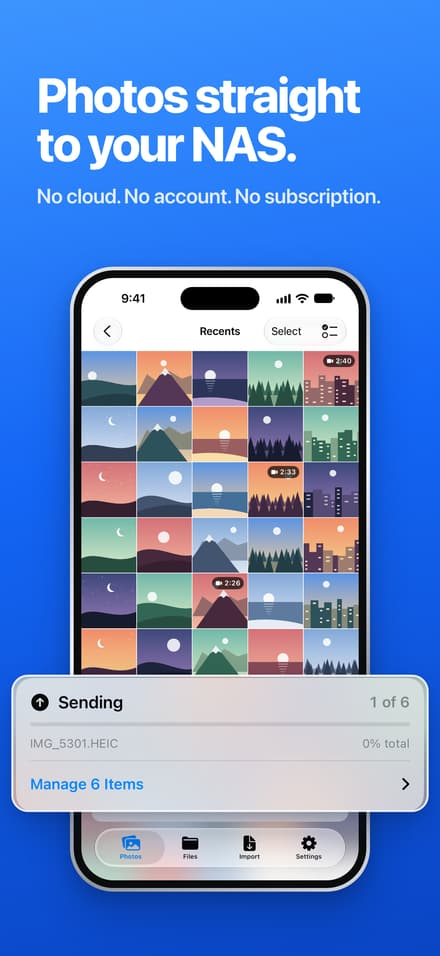
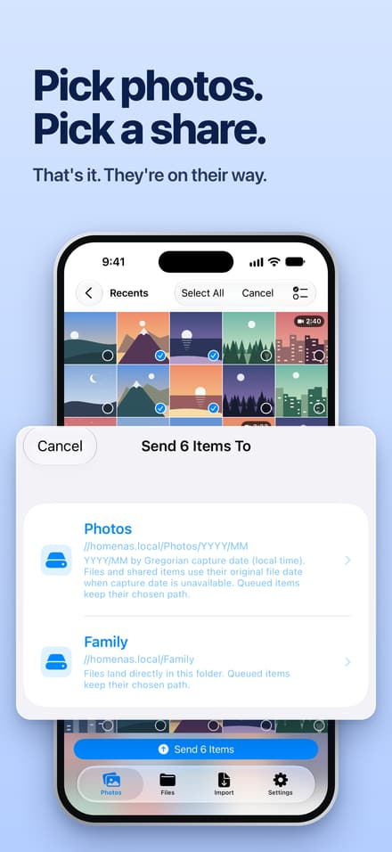
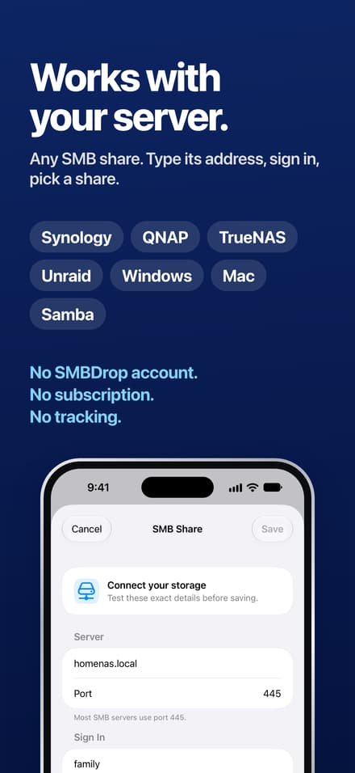
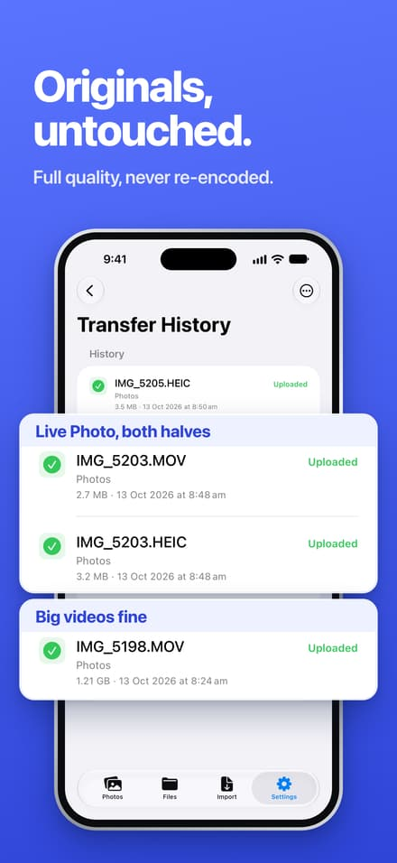
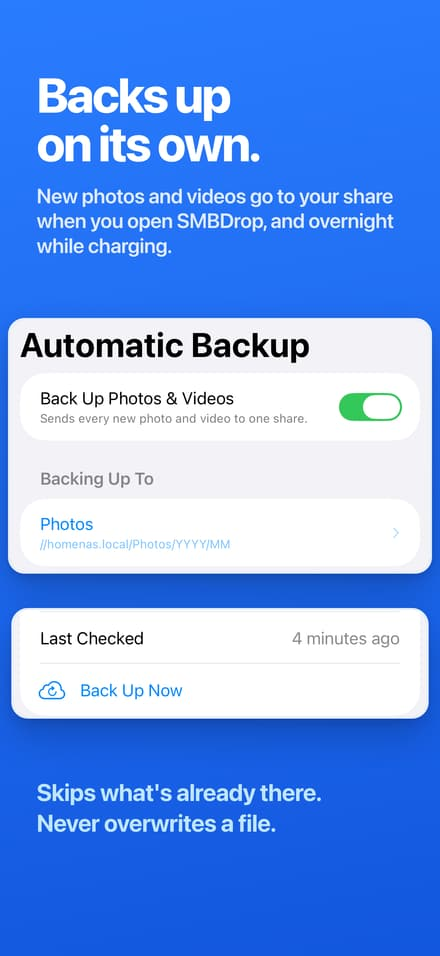
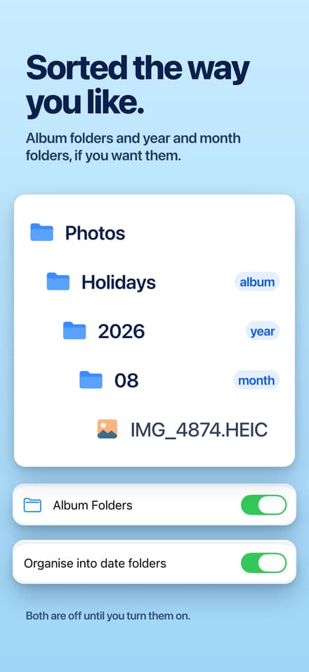
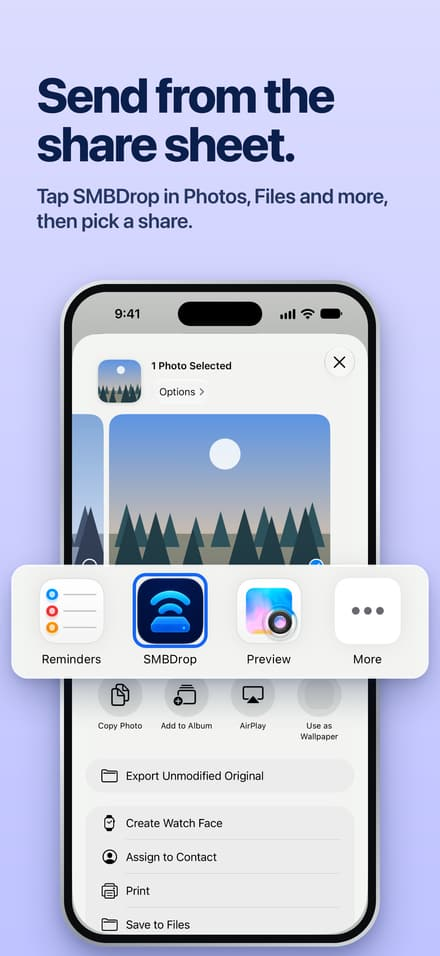
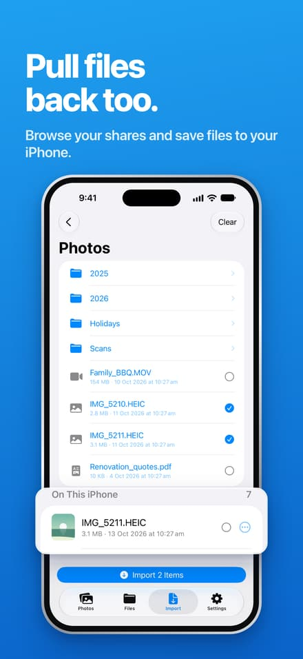

<h1 align="center">SMBDrop</h1>

<strong>Send original photos, videos and files from your iPhone straight to your own NAS or shared folder.</strong> 
No account, no cloud, no subscription. £9.99 once.

  

  
  
  

SMBDrop is an iPhone app for people who keep their own storage at home or in the office. Pick photos or files, tap a share, and they go over your own network to your server, using SMB. You can pull files back onto the phone too.

 

## Originals, untouched

SMBDrop sends the original bytes. Photos keep their metadata, HEIC and video are never re-encoded, and a Live Photo arrives as both its photo and its video. Large videos are fine.

Files already on the share are skipped, and a different file with the same name is never overwritten.

 

## Backs up on its own

Turn on Automatic Backup and new photos and videos go to the share you choose when you open the app. It can also run overnight while your phone charges, when iOS allows it.

When you want the space back, Review Uploaded Photos lets you choose which originals to delete from Photos. Nothing is picked for you.

 

## Sorted your way

File new photos into `YYYY/MM` date folders on each share, or put photos from an album into a folder with the album's name. Both are off until you turn them on.

 

## Send from anywhere

Tap SMBDrop in the share sheet in Photos, Files and other apps, or pick any file with Apple's Files picker. Transfers carry on when you leave the app, with progress on the Lock Screen and in the Dynamic Island, and a notification when they finish. If something fails, the queue keeps it so you can try again.

 

## Pull files back

Browse your shares and save files onto your iPhone. Each import is checked for the right file size and never overwrites a file you already have. Imports appear in the Files app under On My iPhone, so other apps can use them.

 

## Works with your server

Any SMB2 or SMB3 share your iPhone can reach:

- Synology, QNAP, UGREEN, TrueNAS and Unraid
- Windows shared folders
- Mac shared folders (File Sharing with SMB turned on)
- Samba on Linux, including a Raspberry Pi

Type the server's address and sign in, and Find Shares lists the shares on it, so you don't have to type a share name. Custom ports work. Away from home, use a VPN such as Tailscale.

Needs iOS 17 or later.

## Price

£9.99, one-off, on the App Store. No subscription, no in-app purchases and no ads. Updates are included.

## Privacy

Files go straight from your phone to your server, and passwords stay in your iPhone's Keychain. There's no account. The app sends anonymous usage counts (a random install ID, with no names, files or server details), which you can turn off in Settings. The [privacy policy](https://smbdrop.com/privacy?utm_source=github&utm_medium=readme) has the details.

## Coming in 1.5

The next version is on its way. It adds a step-by-step setup guide, backups to a USB drive, a feature board in the app where you can vote on ideas, new Library, Files and Settings tabs with a Files browser, and German, French, Spanish and Japanese.

## Learn more

- [smbdrop.com](https://smbdrop.com/?utm_source=github&utm_medium=readme)
- [Support and common fixes](https://smbdrop.com/support?utm_source=github&utm_medium=readme)
- [All guides](https://smbdrop.com/guides/?utm_source=github&utm_medium=readme)
- [Best ways to back up iPhone photos to a NAS](https://smbdrop.com/guides/best-iphone-to-nas-photo-backup-apps?utm_source=github&utm_medium=readme)
- [How to back up iPhone photos to a Synology NAS](https://smbdrop.com/guides/iphone-photos-to-synology?utm_source=github&utm_medium=readme)
- [How to back up an iPhone without iCloud](https://smbdrop.com/guides/back-up-iphone-without-icloud?utm_source=github&utm_medium=readme)
- [SMBDrop vs the iPhone Files app](https://smbdrop.com/guides/smbdrop-vs-files-app?utm_source=github&utm_medium=readme)
- [Send iPhone photos to your NAS over Tailscale](https://smbdrop.com/guides/iphone-to-nas-over-tailscale?utm_source=github&utm_medium=readme)
- [What's new in each version](https://smbdrop.com/changelog?utm_source=github&utm_medium=readme)

Need help or have an idea? See the [support page](https://smbdrop.com/support?utm_source=github&utm_medium=readme), or use Settings › Request a Feature in the app. Questions aren't answered here on GitHub.

  

---

This repository is the public page for SMBDrop. The app's source code is not public, and nothing here is open source. Screenshots, text and the SMBDrop name and icon are © 2026 Isaac Griffiths. All rights reserved. App Store and the App Store badge are trademarks of Apple Inc.
